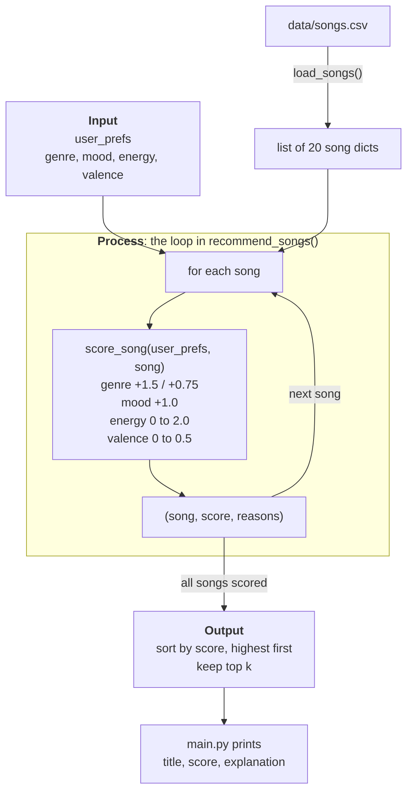
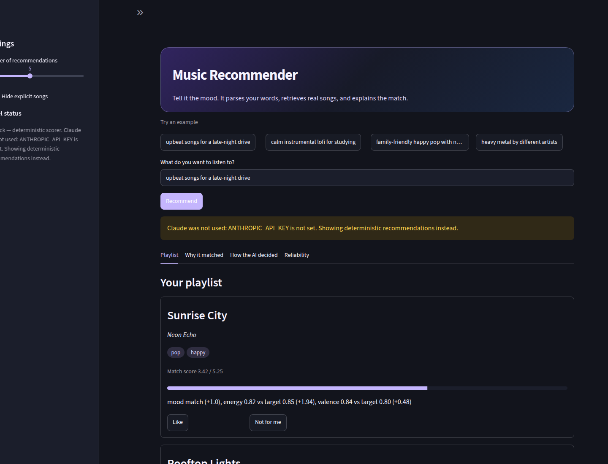

# 🎵 Music Recommender Simulation

## Project Summary

In this project you will build and explain a small music recommender system.

Your goal is to:

- Represent songs and a user "taste profile" as data
- Design a scoring rule that turns that data into recommendations
- Evaluate what your system gets right and wrong
- Reflect on how this mirrors real world AI recommenders

The running app takes a sentence such as "upbeat songs for a late-night drive". Claude turns that sentence into the same preference fields the scorer already uses. The scorer retrieves the closest songs from `data/songs.csv`. Claude then writes the final list and explanations from only those retrieved songs. If the API key is missing, the call fails, or the JSON is unusable, the deterministic scorer answers instead and the CLI says so.

---

## How The System Works

Real-world platforms like Spotify and YouTube predict what users will love by combining two approaches. Collaborative filtering recommends what similar listeners enjoyed. Content-based filtering recommends songs whose attributes resemble what the user already plays. These platforms learn from signals like plays, skips, saves and replays, then score many candidate songs and re-rank them into a final list that balances relevance with variety. My version is a simple content-based recommender. It doesn't use other users' data. Instead, it scores each song by how closely it matches one user's taste profile. It gives the most weight to **energy** and **genre**, then **mood**, with **valence** as a tiebreaker. I left out tempo, danceability and acousticness because in this dataset they are highly correlated with energy and would mostly count the same signal more than once. A separate ranking step then sorts the scored songs and picks the top results, aiming for recommendations that are accurate, easy to explain and not repetitive.

### Song Features and User Profile

- **`Song` features used in scoring:** `genre`, `mood`, `energy`, `valence`. The other columns (`tempo_bpm`, `danceability`, `acousticness`, `instrumentalness`, `popularity`) are loaded but not scored.
- **`UserProfile` stores:** `favorite_genre`, `favorite_mood`, `target_energy` and `target_valence` (default 0.65, the dataset average, meaning no preference). It also has `likes_acoustic`, `prefers_instrumental` and `prefers_popular`, which are reserved for later experiments and not used in the score yet.

### Algorithm Recipe

Each song is scored against the user profile, then songs are sorted by score (highest first) and the top `k` are returned.

| Rule | Points | Notes |
|---|---|---|
| Genre match | **+1.5** | Exact match, case-insensitive |
| Related genre | **+0.75** | Instead of the full match, when one genre contains the other (e.g. `pop` and `indie pop`) |
| Mood match | **+1.0** | Exact match, case-insensitive |
| Energy similarity | **0 to +2.0** | `2.0 × (1 − |song.energy − target_energy|)` |
| Valence similarity | **0 to +0.5** | `0.5 × (1 − |song.valence − target_valence|)`, used as a tiebreaker |

Maximum score is **5.0**. Every rule that awards points adds a short reason (e.g. "genre match (+1.5)") so each recommendation can be explained.

**Why these weights**

- Genre counts more than mood (1.5 vs 1.0) because genre is a more stable preference, and mood is already partly captured by energy and valence (in this dataset `chill` songs sit around 0.3–0.4 energy, `intense` songs around 0.9).
- Energy (up to 2.0) can outweigh a genre match on its own, so a slow song in the right genre no longer beats a song with the right energy and mood. But it can't outweigh genre + mood together (2.5).
- These weights came out of the experiments below: the original weights (genre 2.0, energy 1.5) let genre override everything, and doubling energy (genre 1.0, energy 3.0) made any loud song rank well. See [Experiments You Tried](#experiments-you-tried).
- Most songs in the catalog match neither the genre nor the mood (20 songs, about 17 genres and 15 moods), so energy and valence decide the ranking among them.

**Expected Biases**

- **Genre over-prioritized:** this system might over-prioritize genre and overlook great songs that match the user's mood. A pop song with the wrong mood (e.g. *Gym Hero*, `intense`, for a happy pop fan) can outrank a song with the right mood in a related genre. The related-genre rule reduces this but doesn't remove it.
- **Exact label matching:** genre and mood only count when the text matches. `sad` and `melancholic` count as different moods, and `r&b` gets no credit for a `soul` fan, so songs with similar feel but different labels lose points.
- **Small, uneven catalog:** `lofi` has 3 songs while most genres have 1. Lofi fans get a full list of strong matches; fans of a single-song genre like `metal` get one match and then songs ranked mostly by energy.
- **Filter bubble:** songs in the user's genre always come first, so the system rarely suggests anything new. Nothing in the score rewards variety.
- **Mid-energy songs favored:** for a user near the middle of the energy range, no song can be more than about 0.5 away, so energy barely separates songs. Users at the extremes (very calm or very intense) see stronger energy effects.

### Data Flow



1. **Input:** `load_songs()` reads the CSV into a list of dicts, converting numeric columns to `float`/`int`. The CLI gets `user_prefs` from Claude, or from the keyword fallback when Claude is unavailable.
2. **Process:** `recommend_songs()` loops over every song and calls `score_song()`, which returns `(score, reasons)`. Each song is judged on its own and no song is skipped, so the loop yields one `(song, score, explanation)` per song.
3. **Output:** the scored list is sorted by score (highest first) and cut to the top `k`. In the CLI, that profile comes from Claude's parsed JSON, or from the keyword fallback when Claude is unavailable. `main.py` then prints each song with its retrieval score and explanation.

---

## How the applied system works

1. **Validate.** The CLI and the Streamlit page reject an empty request and anything over 500 characters.
2. **Parse.** Claude (`claude-sonnet-5-5` unless `ANTHROPIC_MODEL` is set) returns a JSON preference profile: genre, mood, energy, valence, and the optional mood tags, decade, language, themes, and explicit flag. The app clamps numbers to 0–1 and drops malformed JSON.
3. **Retrieve.** `load_songs` reads `data/songs.csv`. `recommend_songs` / `score_song` rank that catalog and keep the top 8 songs.
4. **Generate.** Claude sees only that retrieved list, including each song's attributes, retrieval score, and scorer reasons, and writes up to 5 recommendations.
5. **Validate again.** Any title Claude names that was not retrieved is dropped and reported. If nothing valid remains, the app falls back.
6. **Check.** A self-check looks for explicit songs, duplicate artists when the request asks for variety, and a mood or energy that misses the request. If the check fails, the profile or filters are adjusted and retrieval runs once more.
7. **Fall back.** With no API key, an API error, or invalid model output, a small keyword reading of the sentence feeds the same scorer. A follow-up such as "more chill" updates the previous profile instead of starting over. The page states that Claude was not used.

Each of those steps is written with Python `logging` to the terminal and to `logs/recommender.log` (that folder is gitignored). The diagram is `diagrams/architecture.mmd`, rendered at `assets/architecture.png`.

## Getting Started

### Setup

1. Create a virtual environment (optional but recommended):

   ```bash
   python -m venv .venv
   source .venv/bin/activate      # Mac or Linux
   .venv\Scripts\activate         # Windows
   ```

2. Install dependencies:

   ```bash
   pip install -r requirements.txt
   ```

3. Copy the environment file and add your key. Do not commit `.env`.

   ```bash
   cp .env.example .env
   chmod 600 .env
   ```

   Restrict the file to your user before you paste the key. `ANTHROPIC_API_KEY` is required for live Claude calls. `ANTHROPIC_MODEL` is optional and defaults to `claude-sonnet-5-5`.

### Run

From the project root:

```bash
python -m src.main "upbeat songs for a late-night drive"
```

Without a key, the same command still prints a ranked list and a message that the deterministic scorer was used.

### Web UI

From the project root, including VS Code's terminal:

```bash
streamlit run app.py
```

Streamlit opens a browser page. The sidebar sets how many songs to show and whether to hide explicit tracks, and it reports whether the last answer came from Claude or the fallback scorer. Example prompts fill the box in one click. Results are cards with genre and mood chips, a match-score bar, and an explanation. Like / Not for me is remembered for the session and nudges the next refinement ("more chill", "no pop").

The other tabs show a feature comparison chart, the parsed profile, retrieved candidates, dropped titles, the self-check result, and a Reliability dashboard that runs `eval/run_eval.py` on demand. The playlist can be downloaded as CSV.



A screenshot of the "How the AI decided" tab can be added beside this one.

### Evaluate

```bash
python -m eval.run_eval
```

The script runs six requests through `run_pipeline` twice each and prints grounding, consistency, and fallback rates.

### Tests

The tests mock Claude, so they do not need an API key:

```bash
pytest
```

---

## Sample Recommendation Output

These samples are the deterministic scorer on the original hand-built profiles. The CLI now takes a natural-language request instead of looping those profiles. The first line the old runner printed was:

```
Loaded 20 songs from data/songs.csv
```

The first three are typical listeners; the rest are adversarial / edge-case profiles meant to probe the scoring logic.

### High-Energy Pop

```
============================================================
  Top Recommendations: High-Energy Pop
  Profile: pop / happy / energy 0.85
============================================================

1. Sunrise City by Neon Echo
   Score: 4.92 / 5.00   (pop, happy)
   Why:
     - genre match (+1.5)
     - mood match (+1.0)
     - energy 0.82 vs target 0.85 (+1.94)
     - valence 0.84 vs target 0.80 (+0.48)

2. Rooftop Lights by Indigo Parade
   Score: 4.07 / 5.00   (indie pop, happy)
   Why:
     - related genre: indie pop (+0.75)
     - mood match (+1.0)
     - energy 0.76 vs target 0.85 (+1.82)
     - valence 0.81 vs target 0.80 (+0.49)

3. Gym Hero by Max Pulse
   Score: 3.82 / 5.00   (pop, intense)
   Why:
     - genre match (+1.5)
     - energy 0.93 vs target 0.85 (+1.84)
     - valence 0.77 vs target 0.80 (+0.48)

4. Banjo Breakdown by Cedar Creek Ramblers
   Score: 2.46 / 5.00   (bluegrass, playful)
   Why:
     - energy 0.86 vs target 0.85 (+1.98)
     - valence 0.83 vs target 0.80 (+0.49)

5. Laser Bloom by Pulsewave
   Score: 2.29 / 5.00   (edm, euphoric)
   Why:
     - energy 0.95 vs target 0.85 (+1.80)
     - valence 0.79 vs target 0.80 (+0.49)

============================================================
```

### Chill Lofi

```
============================================================
  Top Recommendations: Chill Lofi
  Profile: lofi / chill / energy 0.38
============================================================

1. Library Rain by Paper Lanterns
   Score: 4.94 / 5.00   (lofi, chill)
   Why:
     - genre match (+1.5)
     - mood match (+1.0)
     - energy 0.35 vs target 0.38 (+1.94)
     - valence 0.60 vs target 0.60 (+0.50)

2. Midnight Coding by LoRoom
   Score: 4.90 / 5.00   (lofi, chill)
   Why:
     - genre match (+1.5)
     - mood match (+1.0)
     - energy 0.42 vs target 0.38 (+1.92)
     - valence 0.56 vs target 0.60 (+0.48)

3. Focus Flow by LoRoom
   Score: 3.96 / 5.00   (lofi, focused)
   Why:
     - genre match (+1.5)
     - energy 0.40 vs target 0.38 (+1.96)
     - valence 0.59 vs target 0.60 (+0.49)

4. Spacewalk Thoughts by Orbit Bloom
   Score: 3.27 / 5.00   (ambient, chill)
   Why:
     - mood match (+1.0)
     - energy 0.28 vs target 0.38 (+1.80)
     - valence 0.65 vs target 0.60 (+0.47)

5. Coffee Shop Stories by Slow Stereo
   Score: 2.42 / 5.00   (jazz, relaxed)
   Why:
     - energy 0.37 vs target 0.38 (+1.98)
     - valence 0.71 vs target 0.60 (+0.45)

============================================================
```

### Deep Intense Rock

```
============================================================
  Top Recommendations: Deep Intense Rock
  Profile: rock / intense / energy 0.92
============================================================

1. Storm Runner by Voltline
   Score: 4.92 / 5.00   (rock, intense)
   Why:
     - genre match (+1.5)
     - mood match (+1.0)
     - energy 0.91 vs target 0.92 (+1.98)
     - valence 0.48 vs target 0.35 (+0.43)

2. Gym Hero by Max Pulse
   Score: 3.27 / 5.00   (pop, intense)
   Why:
     - mood match (+1.0)
     - energy 0.93 vs target 0.92 (+1.98)
     - valence 0.77 vs target 0.35 (+0.29)

3. Iron Cathedral by Black Meridian
   Score: 2.33 / 5.00   (metal, angry)
   Why:
     - energy 0.97 vs target 0.92 (+1.90)
     - valence 0.22 vs target 0.35 (+0.43)

4. Laser Bloom by Pulsewave
   Score: 2.22 / 5.00   (edm, euphoric)
   Why:
     - energy 0.95 vs target 0.92 (+1.94)
     - valence 0.79 vs target 0.35 (+0.28)

5. Banjo Breakdown by Cedar Creek Ramblers
   Score: 2.14 / 5.00   (bluegrass, playful)
   Why:
     - energy 0.86 vs target 0.92 (+1.88)
     - valence 0.83 vs target 0.35 (+0.26)

============================================================
```

### Sad Banger (conflict)

```
============================================================
  Top Recommendations: Sad Banger (conflict)
  Profile: blues / sad / energy 0.90
============================================================

1. Last Train Blues by Delta Ray
   Score: 3.98 / 5.00   (blues, sad)
   Why:
     - genre match (+1.5)
     - mood match (+1.0)
     - energy 0.40 vs target 0.90 (+1.00)
     - valence 0.25 vs target 0.20 (+0.47)

2. Iron Cathedral by Black Meridian
   Score: 2.35 / 5.00   (metal, angry)
   Why:
     - energy 0.97 vs target 0.90 (+1.86)
     - valence 0.22 vs target 0.20 (+0.49)

3. Storm Runner by Voltline
   Score: 2.34 / 5.00   (rock, intense)
   Why:
     - energy 0.91 vs target 0.90 (+1.98)
     - valence 0.48 vs target 0.20 (+0.36)

4. Gym Hero by Max Pulse
   Score: 2.15 / 5.00   (pop, intense)
   Why:
     - energy 0.93 vs target 0.90 (+1.94)
     - valence 0.77 vs target 0.20 (+0.21)

5. Laser Bloom by Pulsewave
   Score: 2.10 / 5.00   (edm, euphoric)
   Why:
     - energy 0.95 vs target 0.90 (+1.90)
     - valence 0.79 vs target 0.20 (+0.20)

============================================================
```

### Genre vs Vibe (conflict)

```
============================================================
  Top Recommendations: Genre vs Vibe (conflict)
  Profile: classical / euphoric / energy 0.95
============================================================

1. Laser Bloom by Pulsewave
   Score: 3.44 / 5.00   (edm, euphoric)
   Why:
     - mood match (+1.0)
     - energy 0.95 vs target 0.95 (+2.00)
     - valence 0.79 vs target 0.90 (+0.45)

2. Gym Hero by Max Pulse
   Score: 2.40 / 5.00   (pop, intense)
   Why:
     - energy 0.93 vs target 0.95 (+1.96)
     - valence 0.77 vs target 0.90 (+0.43)

3. Banjo Breakdown by Cedar Creek Ramblers
   Score: 2.29 / 5.00   (bluegrass, playful)
   Why:
     - energy 0.86 vs target 0.95 (+1.82)
     - valence 0.83 vs target 0.90 (+0.46)

4. Sunrise City by Neon Echo
   Score: 2.21 / 5.00   (pop, happy)
   Why:
     - energy 0.82 vs target 0.95 (+1.74)
     - valence 0.84 vs target 0.90 (+0.47)

5. Storm Runner by Voltline
   Score: 2.21 / 5.00   (rock, intense)
   Why:
     - energy 0.91 vs target 0.95 (+1.92)
     - valence 0.48 vs target 0.90 (+0.29)

============================================================
```

### Messy Input

```
============================================================
  Top Recommendations: Messy Input
  Profile:  Pop  / HAPPY / energy 0.80
============================================================

1. Sunrise City by Neon Echo
   Score: 4.87 / 5.00   (pop, happy)
   Why:
     - genre match (+1.5)
     - mood match (+1.0)
     - energy 0.82 vs target 0.80 (+1.96)
     - valence 0.84 vs target 0.65 (+0.41)

2. Rooftop Lights by Indigo Parade
   Score: 4.09 / 5.00   (indie pop, happy)
   Why:
     - related genre: indie pop (+0.75)
     - mood match (+1.0)
     - energy 0.76 vs target 0.80 (+1.92)
     - valence 0.81 vs target 0.65 (+0.42)

3. Gym Hero by Max Pulse
   Score: 3.68 / 5.00   (pop, intense)
   Why:
     - genre match (+1.5)
     - energy 0.93 vs target 0.80 (+1.74)
     - valence 0.77 vs target 0.65 (+0.44)

4. Night Drive Loop by Neon Echo
   Score: 2.32 / 5.00   (synthwave, moody)
   Why:
     - energy 0.75 vs target 0.80 (+1.90)
     - valence 0.49 vs target 0.65 (+0.42)

5. Banjo Breakdown by Cedar Creek Ramblers
   Score: 2.29 / 5.00   (bluegrass, playful)
   Why:
     - energy 0.86 vs target 0.80 (+1.88)
     - valence 0.83 vs target 0.65 (+0.41)

============================================================
```

### Out of Range Energy

```
============================================================
  Top Recommendations: Out of Range Energy
  Profile: metal / angry / energy 1.50
============================================================

1. Iron Cathedral by Black Meridian
   Score: 4.72 / 5.00   (metal, angry)
   Why:
     - genre match (+1.5)
     - mood match (+1.0)
     - energy 0.97 vs target 1.00 (+1.94)
     - valence 0.22 vs target 0.65 (+0.28)

2. Laser Bloom by Pulsewave
   Score: 2.33 / 5.00   (edm, euphoric)
   Why:
     - energy 0.95 vs target 1.00 (+1.90)
     - valence 0.79 vs target 0.65 (+0.43)

3. Gym Hero by Max Pulse
   Score: 2.30 / 5.00   (pop, intense)
   Why:
     - energy 0.93 vs target 1.00 (+1.86)
     - valence 0.77 vs target 0.65 (+0.44)

4. Storm Runner by Voltline
   Score: 2.23 / 5.00   (rock, intense)
   Why:
     - energy 0.91 vs target 1.00 (+1.82)
     - valence 0.48 vs target 0.65 (+0.41)

5. Banjo Breakdown by Cedar Creek Ramblers
   Score: 2.13 / 5.00   (bluegrass, playful)
   Why:
     - energy 0.86 vs target 1.00 (+1.72)
     - valence 0.83 vs target 0.65 (+0.41)

============================================================
```

### Unknown Genre

```
============================================================
  Top Recommendations: Unknown Genre
  Profile: k-pop / happy / energy 0.80
============================================================

1. Sunrise City by Neon Echo
   Score: 3.37 / 5.00   (pop, happy)
   Why:
     - mood match (+1.0)
     - energy 0.82 vs target 0.80 (+1.96)
     - valence 0.84 vs target 0.65 (+0.41)

2. Rooftop Lights by Indigo Parade
   Score: 3.34 / 5.00   (indie pop, happy)
   Why:
     - mood match (+1.0)
     - energy 0.76 vs target 0.80 (+1.92)
     - valence 0.81 vs target 0.65 (+0.42)

3. Night Drive Loop by Neon Echo
   Score: 2.32 / 5.00   (synthwave, moody)
   Why:
     - energy 0.75 vs target 0.80 (+1.90)
     - valence 0.49 vs target 0.65 (+0.42)

4. Banjo Breakdown by Cedar Creek Ramblers
   Score: 2.29 / 5.00   (bluegrass, playful)
   Why:
     - energy 0.86 vs target 0.80 (+1.88)
     - valence 0.83 vs target 0.65 (+0.41)

5. Concrete Sonnets by Verse Theory
   Score: 2.28 / 5.00   (hip hop, confident)
   Why:
     - energy 0.71 vs target 0.80 (+1.82)
     - valence 0.58 vs target 0.65 (+0.46)

============================================================
```

### No Signal

```
============================================================
  Top Recommendations: No Signal
  Profile: none / none / energy 0.50
============================================================

1. Velvet Hours by Amara Lux
   Score: 2.37 / 5.00   (r&b, romantic)
   Why:
     - energy 0.52 vs target 0.50 (+1.96)
     - valence 0.68 vs target 0.50 (+0.41)

2. Midnight Coding by LoRoom
   Score: 2.31 / 5.00   (lofi, chill)
   Why:
     - energy 0.42 vs target 0.50 (+1.84)
     - valence 0.56 vs target 0.50 (+0.47)

3. Gravel Road Gospel by Hollow Pines
   Score: 2.28 / 5.00   (country, nostalgic)
   Why:
     - energy 0.58 vs target 0.50 (+1.84)
     - valence 0.62 vs target 0.50 (+0.44)

4. Focus Flow by LoRoom
   Score: 2.25 / 5.00   (lofi, focused)
   Why:
     - energy 0.40 vs target 0.50 (+1.80)
     - valence 0.59 vs target 0.50 (+0.46)

5. Island Time by Sol Harbor
   Score: 2.21 / 5.00   (reggae, uplifting)
   Why:
     - energy 0.55 vs target 0.50 (+1.90)
     - valence 0.88 vs target 0.50 (+0.31)

============================================================
```

**Screenshot or video** *(optional)*: <!-- Insert a screenshot or demo video link here -->

---

## Experiments You Tried

### Experiment 1: Weight Shift (double energy, halve genre)

**Change:** genre match 2.0 → 1.0, related genre 1.0 → 0.5, energy similarity max 1.5 → 3.0. Mood (+1.0) and valence (0 to +0.5) unchanged. Max score goes from 5.0 to 5.5.

**Top 5 before → after** (scores in parentheses):

| Profile | Baseline (genre 2.0, energy 1.5) | Weight shift (genre 1.0, energy 3.0) |
|---|---|---|
| High-Energy Pop | Sunrise City (4.94), Gym Hero (3.86), Rooftop Lights (3.86), Cloud Static (2.04), Banjo Breakdown (1.97) | Sunrise City (5.39), Rooftop Lights (4.73), Gym Hero (4.25), Banjo Breakdown (3.45), Laser Bloom (3.20) |
| Chill Lofi | Library Rain, Midnight Coding, Focus Flow, Spacewalk Thoughts, Coffee Shop Stories | Same order |
| Deep Intense Rock | Storm Runner, Gym Hero, Iron Cathedral, Laser Bloom, Night Drive Loop | Storm Runner, Gym Hero, Iron Cathedral, Laser Bloom, **Banjo Breakdown** |
| Sad Banger (conflict) | Last Train Blues (4.22), Iron Cathedral (1.89), Storm Runner (1.84), … | Last Train Blues (3.98), Storm Runner (3.33), Iron Cathedral (3.28), … |
| Genre vs Vibe (conflict) | Laser Bloom (2.94), **Nocturne in Grey (2.50)**, Gym Hero, Banjo Breakdown, Sunrise City | Laser Bloom (4.45), Gym Hero, Banjo Breakdown, Storm Runner, Iron Cathedral (Nocturne gone) |
| No Signal | Velvet Hours (1.88) … Island Time (1.73) | Velvet Hours (3.35) … Focus Flow (3.16) |

**What I observed:**

- **Typical profiles barely changed at the top.** The #1 song stayed the same for every profile, because the best songs match on genre, mood *and* energy, so reweighting doesn't change their relative position.
- **Energy now decides the tail.** Slots 4–5 filled up with any high-energy song regardless of style: Banjo Breakdown (bluegrass) and Laser Bloom (EDM) entered High-Energy Pop and Deep Intense Rock, while Cloud Static (dream pop, energy 0.33) dropped out of the pop list. Recommendations got more "energy-accurate" but less stylistically coherent.
- **Genre stopped overriding the vibe.** In Genre vs Vibe, Nocturne in Grey (classical but energy 0.18, melancholic) fell out of the top 5 entirely. This is the main improvement.
- **Genre + mood still beat energy.** Sad Banger still gets Last Train Blues (energy 0.40) at #1. Its lead shrank from 2.3 points to 0.65, but 2.0 points of category matches still outweigh a 0.5 energy gap (which now costs 1.5).
- **Scores compress.** With energy worth 3.0, almost every song earns 2.5+ points just from being in a common energy range, so the gap between "good match" and "filler" narrows (No Signal: everything between 3.16 and 3.35). The score number tells you less about match quality.

**Conclusion:** the system is fairly robust for listeners whose preferences agree with each other, and sensitive for conflicting ones. Doubling energy fixes the "genre bulldozes everything" problem but creates a new one: "anything loud is a rock song." A middle ground (e.g. genre 1.5, energy 2.0) may balance both.

### Experiment 2: Middle ground (genre 1.5, energy 2.0), the current weights

**Change:** starting from the original weights, genre match 2.0 → 1.5, related genre 1.0 → 0.75, energy similarity max 1.5 → 2.0. Mood and valence unchanged. Max score stays at exactly **5.0**.

**Math check:** a song identical to a profile scores exactly 5.0. All 180 scores (20 songs × 9 profiles) fall between 0.64 and 4.94, so nothing is negative or above the max, even for energy 1.5. The numbers in each song's reasons add up to its score (within 0.005 rounding). Hand check: Sad Banger vs Last Train Blues = 1.5 + 1.0 + 2.0×0.5 + 0.5×0.95 = 3.975, and the code returns 3.975.

**Top 5 across all three versions:**

| Profile | Original (2.0 / 1.5) | Double energy (1.0 / 3.0) | Middle ground (1.5 / 2.0) |
|---|---|---|---|
| High-Energy Pop | Sunrise City, Gym Hero, Rooftop Lights, Cloud Static, Banjo Breakdown | Sunrise City, Rooftop Lights, Gym Hero, Banjo Breakdown, Laser Bloom | Sunrise City (4.92), Rooftop Lights (4.07), Gym Hero (3.82), Banjo Breakdown (2.46), Laser Bloom (2.29) |
| Sad Banger (conflict) | Last Train Blues leads by 2.33 | Last Train Blues leads by 0.65 | Last Train Blues (3.98) leads by 1.63 |
| Genre vs Vibe (conflict) | Nocturne in Grey at #2 | Nocturne gone | Nocturne gone; Laser Bloom (3.44), Gym Hero, Banjo Breakdown, Sunrise City, Storm Runner |
| No Signal (score spread of top 5) | 1.73–1.88 | 3.16–3.35 | 2.21–2.37 |

**What I observed:**

- **#1 is stable.** Every profile's top song is the same in all three versions.
- **Keeps the main fix from Experiment 1.** The classical-but-slow song no longer shows up for a high-energy euphoric listener.
- **Genre + mood still win conflicts, by less.** Sad Banger still gets the slow blues song at #1. This is arguably correct (it matches 2 of the 3 stated preferences), but a listener who mainly cares about energy would disagree.
- **Slots 4–5 are still energy-driven.** Banjo Breakdown and Laser Bloom remain in the pop and rock lists. This is a dataset limit as much as a weight problem: most genres have only one song, so after the genre matches run out, energy decides.
- **Scores keep their meaning.** Max is back at 5.0 and filler songs score around 2.2–2.5, clearly below real matches (3.3+).

**Conclusion:** I kept the middle-ground weights. They're less sensitive than either extreme: genre no longer overrides a clear energy/mood mismatch, but loud songs don't take over the list either.

---

## Limitations and Risks

- **Tiny, uneven catalog.** There are only 20 songs, and 15 of the 17 genres have just one song. A lofi fan gets three real matches; a metal fan gets one, and the rest of the list is filler chosen by energy.
- **Bias against sad and dark songs.** When a listener doesn't set a valence, the system assumes "medium happy" (0.65), so dark songs lose points for everyone. In a test with 1,360 simulated listeners, Iron Cathedral and Last Train Blues were the two least-recommended songs.
- **Some songs are shown far more than others.** In the same test, the most-shown song appeared about 5× as often as the least-shown one. Nothing in the score rewards variety, so the same songs keep coming back.
- **Exact labels only.** "sad" and "melancholic" count as different moods, rock and metal get no credit as related genres, and "k-pop" doesn't match pop.
- **Conflicting preferences.** Matching genre and mood together still beats energy, so a "sad but high-energy" listener gets a slow blues song at #1.
- **Ignored preferences.** `likes_acoustic`, `prefers_instrumental` and `prefers_popular` are stored but not used in the score.
- **No sense of confidence.** When nothing fits, the system still shows 5 songs with no warning that they're weak matches.
- **No real understanding of music.** It doesn't know lyrics, language, artists or listening history, only a few numbers and labels per song.

See the [model card](model_card.md) for more detail.

---

## Reflection

Read and complete `model_card.md`:

[**Model Card**](model_card.md)

I learned that a recommender like this doesn't really "understand" music. It turns each song into a few numbers and labels (genre, mood, energy, valence), compares them to what the listener asked for, and gives points for each match. The songs with the most points become the recommendations. What surprised me is how much the point values matter: when I changed how much genre and energy were worth, the recommendations changed for almost every listener, even though the data stayed the same. The point values are basically the system's opinion about what matters in music.

I also saw how bias can sneak in without anyone meaning it to. When a listener doesn't say whether they want happy or sad music, my system assumes "medium," which quietly gives sad songs fewer points. When I tested 1,360 pretend listeners, the darkest songs were among the least recommended, and some songs showed up five times more often than others. The catalog itself also causes unfairness: lofi has three songs but most genres have only one, so fans of smaller genres get worse recommendations. In a real app with millions of songs, these small choices could decide which artists get heard at all.


